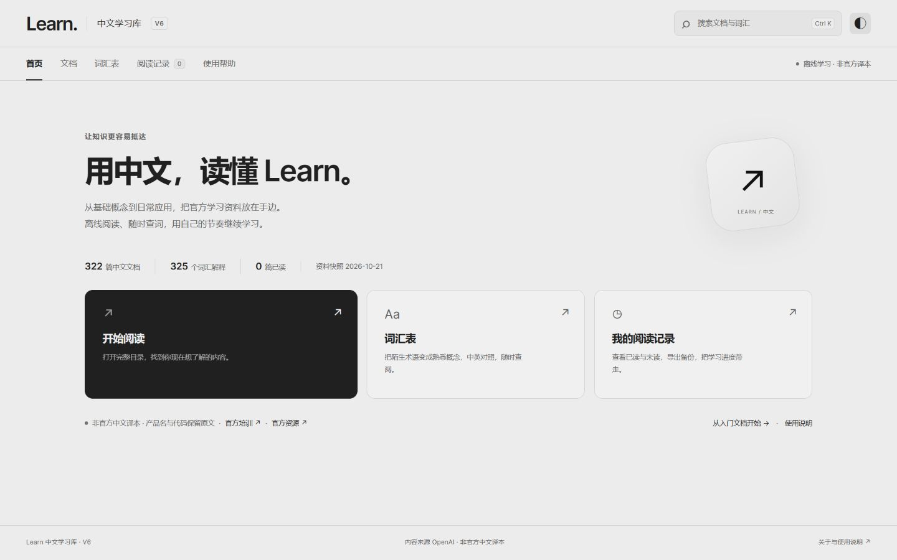
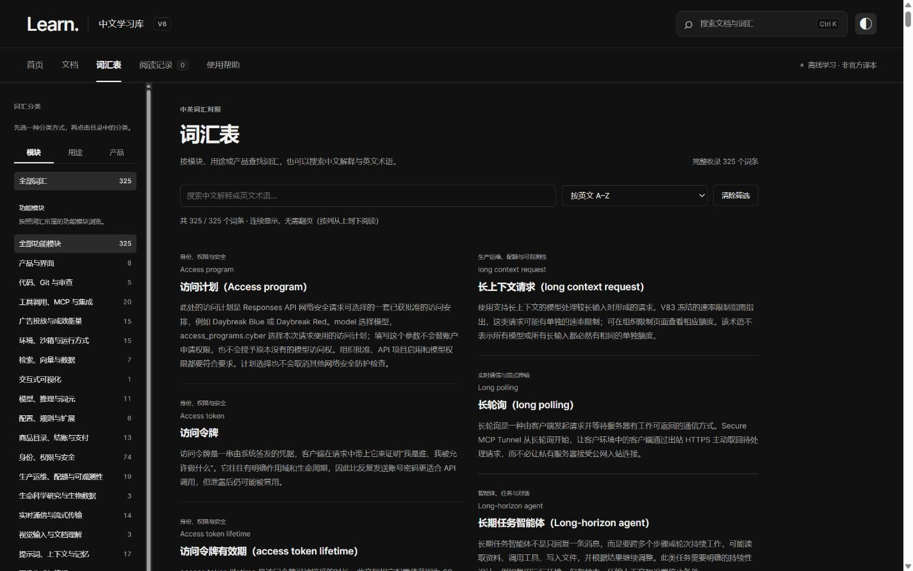
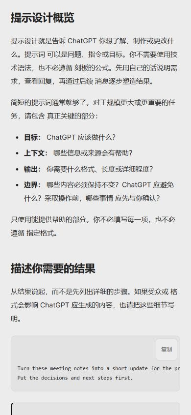
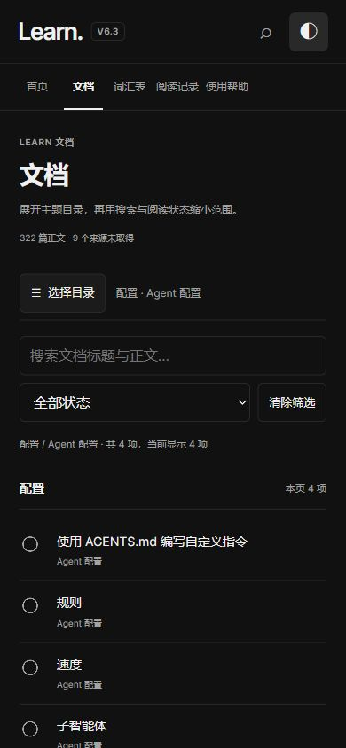

**简体中文** · [English](README.en.md)

# OpenAI Learn 中文学习库

### 用中文读教程，遇到疑问，随时对照英文。

我把 OpenAI Learn 的教程整理成了一个中文学习库：**322 篇文档、325 个词汇解释**，可以在线阅读，也可以下载后在浏览器里离线打开。搜索、章节目录和阅读记录放在一起，方便一点点学，也方便随时回来查。

**[打开网页版 ↗](https://learn-chinese-v6.dimmensck.chatgpt.site)** · **[下载完整学习包](https://github.com/DimmensCK/OpenAI-Learn-Chinese/releases/latest)** · [三步开始](#start) · [查看功能](#features)

非官方 · AI 辅助译文 · 内容快照 **2026-10-21** · 下载版阅读器 **V6**

[](https://github.com/DimmensCK/OpenAI-Learn-Chinese/actions/workflows/validate.yml)



> 这是个人维护的中文学习项目，没有 OpenAI 官方背书。译文尚未逐篇独立人工审校；价格、权限和产品行为请回到当前官方文档核实。[来源和权利范围](NOTICE.md)

<a id="features"></a>

## 读起来，查起来，都顺手一些

| 想做什么 | 学习库怎么帮你 |
|---|---|
| 从一篇教程开始 | 按主题浏览 Learn 文档，长文章按章节阅读，保留代码和提示词 |
| 不确定一句话的意思 | 同篇切换中文译文与英文快照，沿来源链接查看官网 |
| 忘了一个术语 | 搜索文档和词汇；325 个词条提供简明解释与分类 |
| 继续上次的学习 | 标记已读或未读，按阅读状态筛选，导出和导入进度 |
| 换个舒服的阅读环境 | 深浅主题、窄屏布局；下载版的已保存内容可离线阅读 |

界面使用原生 HTML、CSS 和 JavaScript，不需要账号、API Key 或后端服务。正文按需加载，浏览器直接打开就能读。

### 对照英文，搜索文档和术语

按 **Ctrl K**（Mac 为 **⌘ K**）搜索标题、正文或英文术语。进入文章后可以切换中英文、选择章节；看完点一下“标为已读”。浏览器的 Ctrl F 只搜索当前显示的章节，跨文章查询请用页面顶部的搜索。



### 手机上也能读

网页版适合在手机上直接打开。下面两张是网页版 **V6.3** 在手机尺寸浏览器视口中的真实截图；下载版 **V6** 也有窄屏布局，但导航细节不同。

<p align="center">
  
  &nbsp;&nbsp;
  
</p>

[查看截图来源和版本](docs/assets/MEDIA.md)

<a id="start"></a>

## 三步开始

1. 打开 [Releases 下载页](https://github.com/DimmensCK/OpenAI-Learn-Chinese/releases/latest)，在 **Assets（资源）** 中下载 **Source code (zip)**。它包含完整学习库和阅读器。
2. **完整解压**到任意普通文件夹，保留“开始学习.cmd”和“学习资料”文件夹的相对位置。
3. Windows 双击 **开始学习.cmd**。macOS、Linux，或不使用启动器时，直接用浏览器打开 **学习资料/index.html**。

阅读时无需安装 Node.js、Python、浏览器扩展，也无需启动服务器。不要直接在压缩包里运行；建议用较新的 Chrome、Edge 或 Firefox。手机本地文件的打开能力取决于系统和浏览器，手机阅读优先使用网页版。

也可以在仓库上方选择 **Code → Download ZIP** 下载当前源码，解压后按相同步骤打开。Release ZIP 是固定版本，源码 ZIP 则随主分支更新。

### 在线和下载版，怎么选？

| | 网页版 | 下载版 |
|---|---|---|
| 入口 | [直接打开](https://learn-chinese-v6.dimmensck.chatgpt.site) | 下载并完整解压 |
| 当前界面版本 | V6.3 | V6 |
| 网络 | 访问站点需要联网，部分网络环境可能受限 | 已保存的正文、词汇、搜索及阅读标记可离线使用 |
| 资料 | 2026-10-21 Learn 快照 | 同日期快照，322 篇正文及 325 个词条 |
| 阅读记录 | 当前浏览器、当前站点本地保存 | 当前浏览器、当前本地地址保存 |
| 跨设备继续读 | 导出 JSON 后，在另一端导入 | 同左；不会自动云同步 |

外部网站、视频、下载、动态演示，以及部分系统语音需要联网。离线包保留英文快照和媒体入口，不包含所有外部媒体文件。

## 这份资料包括什么

| 内容 | 数量与范围 |
|---|---|
| 中文文档及英文快照 | **322 篇**，来源于 `learn.chatgpt.com` |
| 词汇解释 | **325 个**，保留已有来源链接 |
| 来源未取得的目录项 | **9 项**，有明确提示，不计入 322 篇正文 |
| 快照日期 | **2026-10-21**，不会自动追踪官网更新 |
| 原稿状态 | 279 篇初译、43 篇已复核；这些状态不等于人工专业审校 |

内容涉及 ChatGPT、Codex、提示设计及 Learn 中的工作流教程。本仓库只发布 **Learn 学习库**，不包含另一套 Developers 文档正文库。部分词条的参考链接可能指向 Developers。

每篇保留官方来源地址与来源校验值，方便追溯；这些校验值不是“译文绝对正确”的证明。完整细节见[使用说明](学习资料/使用说明.md)和[来源与权利说明](学习资料/来源与权利说明.md)。

## 阅读记录怎么保存

在“阅读记录”中点击导出，得到一个 JSON 文件。更换设备、浏览器、存放路径或更新版本前先导出，再在新位置导入。导入会合并记录。

记录保存在浏览器本机存储中，不上传服务器。清理浏览器数据、无痕模式或浏览器限制可能使记录丢失或无法持久保存；请自行保管备份。网页版和下载版地址不同，记录不会自动互通。

## 常见问题

<details>
<summary>打开后空白，或者提示资料未加载？</summary>

确认已经完整解压，且 `index.html`、`catalog.js`、`app.js`、`app.css`、`pages/` 和 `glossary/` 都在“学习资料”中。不要只下载一个 HTML 文件。启用浏览器 JavaScript，并尝试用较新的浏览器重新打开。

</details>

<details>
<summary>这是 OpenAI 官方中文文档吗？翻译全都人工校对了吗？</summary>

都不是。项目使用 AI 辅助翻译与复核，没有 OpenAI 官方背书，也没有逐篇独立人工审校。遇到术语、数字或操作描述有疑问时，请对照英文和当前官方来源；欢迎提交具体勘误。

</details>

<details>
<summary>能下载源码，自己改界面或维护内容吗？</summary>

可以下载阅读器源码。本项目自有阅读器代码采用 MIT 许可，范围见 [LICENSE.md](LICENSE.md)。原文、译文、词条和截图中的第三方内容不因此取得 MIT 或 CC 许可。公开再分发资料或添加新内容时，需要核实对应权利和适用条件。

</details>

## 参与维护

发现错译时，请在 [Issues](https://github.com/DimmensCK/OpenAI-Learn-Chinese/issues) 附上文章标题、官方链接、相关原句和建议译法。界面问题请说明浏览器、设备尺寸和复现步骤，截图前遮住私人信息。也欢迎提交有明确范围的 Pull Request。

阅读器是静态文件项目。开发检查只需 Node.js 22 或更新版本：

```sh
node scripts/validate.mjs
```

这个检查核对资料结构、数量、载荷和来源，不判断翻译质量。查看[贡献指南](CONTRIBUTING.md)了解文件布局、内容修改和发布检查。

```text
开始学习.cmd              Windows 启动入口
学习资料/
  index.html              浏览器入口
  app.js / app.css        阅读器交互与样式
  catalog.js              文档、词汇目录与搜索索引
  pages/                  322 篇中英文正文
  glossary/               325 个词汇载荷
docs/assets/              主页截图及来源说明
scripts/validate.mjs      学习包结构检查
```

## 来源、许可与后续更新

感谢 [OpenAI Learn](https://learn.chatgpt.com) 提供原始学习资料。项目由 [DimmensCK](https://github.com/DimmensCK) 整理维护；官方名称和商标归各自权利人所有。

**代码与学习内容的许可分开处理。** 自有阅读器代码按 [MIT](LICENSE-CODE) 提供；原文、译文、词条和第三方内容保留各自权利。目前没有确认涵盖整库公开镜像及翻译再分发的明确授权，项目不会将公开可见或 AI 辅助翻译解释为开放内容许可。详情及权利反馈方式见 [NOTICE.md](NOTICE.md)。

后续会继续修正译文、改善阅读体验，并单独整理 Developers 学习库。具体内容以发布记录为准。如果这份学习库对你有用，可以点一个 Star，方便以后找回来；有哪一篇最需要修订，也欢迎直接告诉我。
