<p align="center"><a href="../.github/README.md">简体中文</a> · <strong>English</strong></p>

<h1 align="center">OpenAI Learn in Chinese</h1>

<p align="center">Read in Chinese. Check the saved English whenever you need to.</p>

<p align="center">
  <strong><a href="https://learn-chinese-v6.dimmensck.chatgpt.site">Open the live reader ↗</a></strong>
  &nbsp; · &nbsp;
  <a href="https://github.com/DimmensCK/OpenAI-Learn-Chinese/releases/latest">Download the complete library</a>
  &nbsp; · &nbsp;
  <a href="#features">Explore the features</a>
</p>

I put together a Chinese-language library of OpenAI Learn tutorials: **322 bilingual articles and 325 glossary entries**. Open the hosted version to try it immediately, or download a complete copy to read on your computer.

Articles, search, glossary links and reading marks share one reader. Start with a topic you want to learn, or look up the passage you need for a particular question.

<p align="center">
  <a href="https://learn-chinese-v6.dimmensck.chatgpt.site">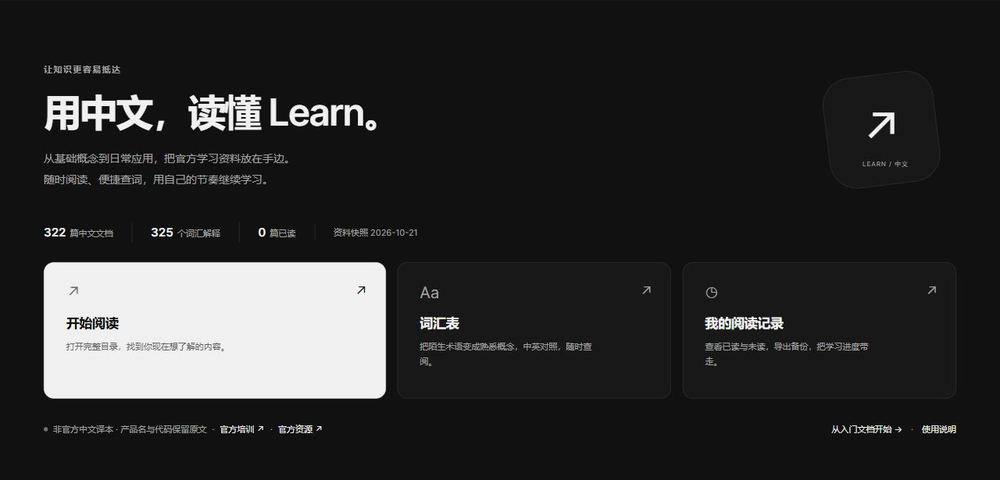</a>
</p>

<p align="center"><a href="https://learn-chinese-v6.dimmensck.chatgpt.site"><strong>Try the Learn Chinese library · hosted on Sites ↗</strong></a></p>

Unofficial · AI-assisted translations · Content snapshot **2026-10-21** · Hosted reader **V6.3** / Downloadable reader **V6**

[](https://github.com/DimmensCK/OpenAI-Learn-Chinese/actions/workflows/validate.yml)

> This is a personally maintained project, with no official OpenAI endorsement. The translations have not been independently human-reviewed article by article. Check official sources for current pricing, access and product behavior. [Sources and rights](legal/NOTICE.md)

<a id="features"></a>

## Find a lesson, read it, and keep your place in the library

The feature images below show the actual hosted V6.3 reader. Desktop images focus on relevant areas of the interface; phone images use a phone-sized browser viewport. They are not generated mockups. [Screenshot provenance and versions](assets/MEDIA.md)

### 01 · Start with a topic, then narrow the list

Expand a subject such as Overview, Features or Configuration, then choose a group. Add a keyword or a read/unread filter to narrow the directory to what you want to study now.

Saved articles and entries whose source was unavailable are identified separately. You can browse a subject before searching, without having to remember an exact article title.

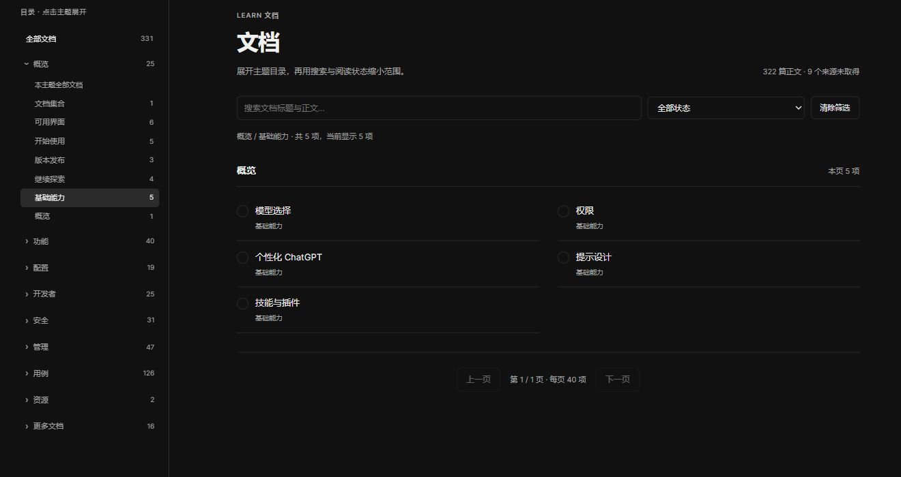

[Open the document directory ↗](https://learn-chinese-v6.dimmensck.chatgpt.site/#/docs)

### 02 · Start with the word you remember

Open the search at the top, or press **Ctrl K** (**⌘ K** on Mac). A Chinese keyword or English term searches articles and glossary entries together. Types, titles and matching snippets help you decide what to open. The screenshot searches for “上下文” (context), returning both documents and terms.

Search matches saved text; it does not generate an answer. Try a shorter keyword if needed. Your browser's Ctrl F remains useful for searching the current page.

<p align="center">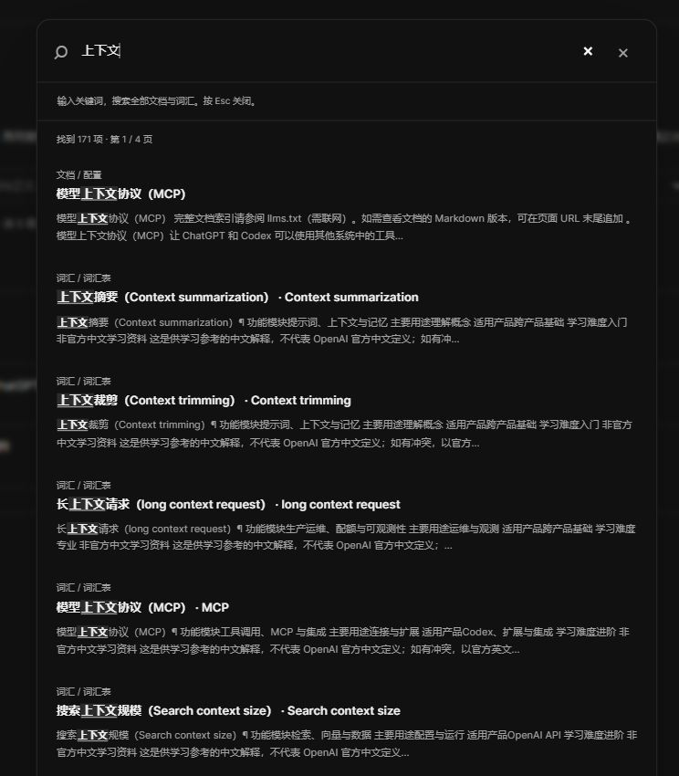</p>

### 03 · Navigate long articles and look up related terms

The hosted reader shows the full article in the middle, the library directory on the left, and page contents and related terms on the right. Jump to a section from the contents, then open a matched glossary entry when a term needs explaining. Code and English prompts remain in the article, with a copy control beside code blocks.

Downloadable V6 handles some long articles differently, using chapters and Previous / Next navigation. This screenshot shows the hosted full-article layout.

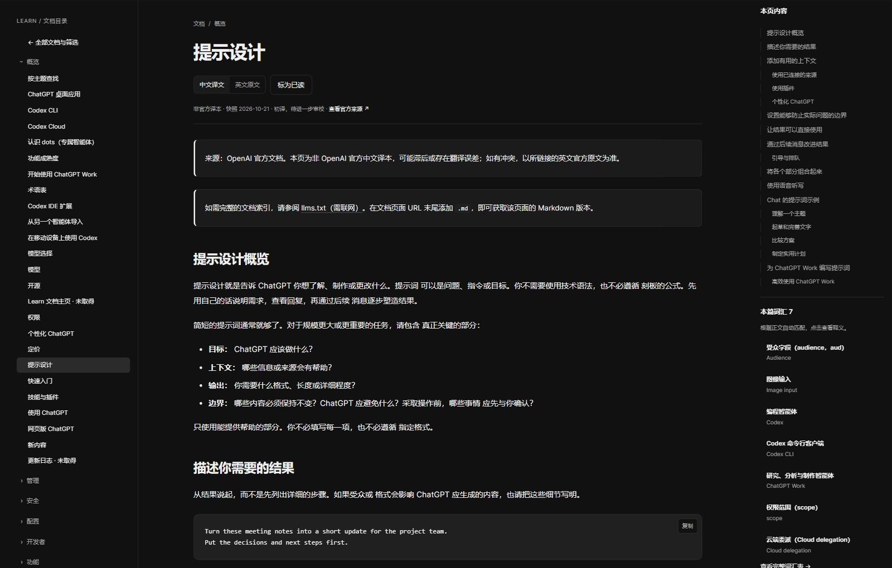

[Read the prompting guide ↗](https://learn-chinese-v6.dimmensck.chatgpt.site/#/article/a-0310706ee8617b64)

### 04 · Read the translation, then check the English

Switch between “中文译文” (Chinese translation) and “英文原文” (saved English text) within the same article. If a term, number or instruction seems unclear, the source wording is close at hand.

The English version is a historical snapshot too. Use “查看官方来源” to visit the official source when you need current information. The saved text helps with comparison; translation errors may still remain.

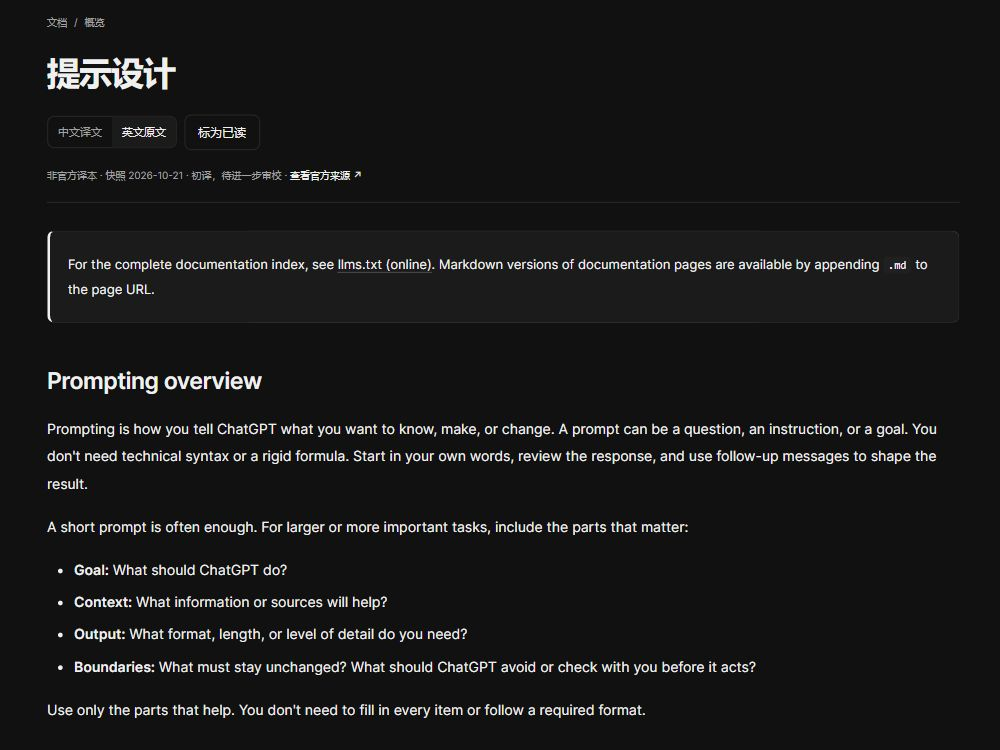

### 05 · Look up a term, or browse its category

Browse **325 glossary entries** by module, use or product, or search Chinese explanations and English names. Categories and keywords work together. Active filters are listed individually so you can remove one without clearing everything.

Cards show a short explanation before you open the complete entry. Matching glossary entries appear in a continuous list. This applies to the glossary; the document directory and global search still use pagination.

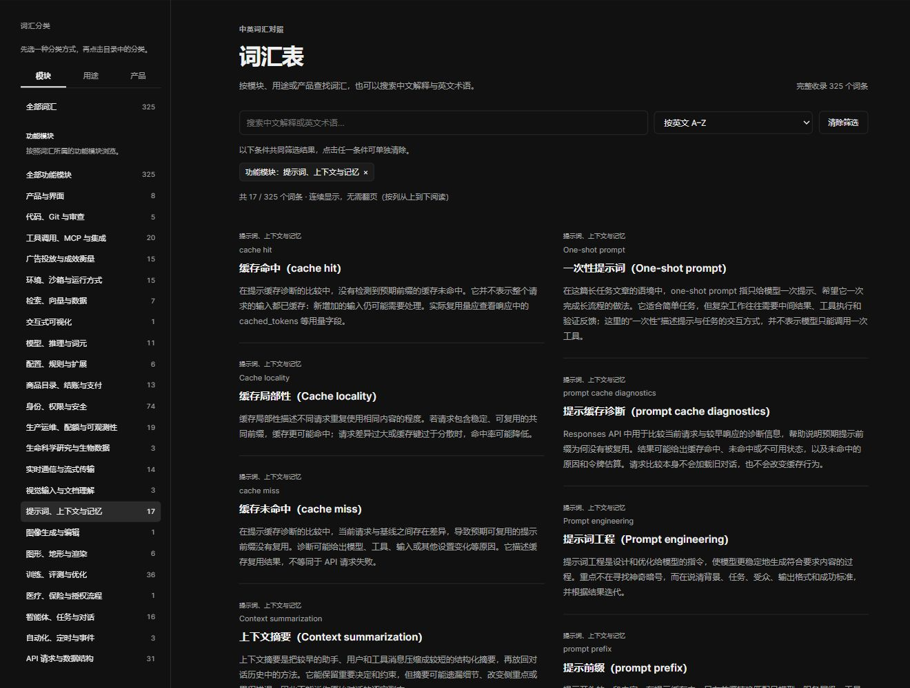

[Open the glossary ↗](https://learn-chinese-v6.dimmensck.chatgpt.site/#/glossary)

### 06 · Mark what you have read

Mark an article as read when you finish, or return it to unread when you want to revisit it. Filter the directory by reading status, or open Reading history to see the articles you marked.

Records stay in the current browser, without a library account. Export a JSON backup before changing devices, browsers or local folders, then import it into a reader that supports that backup format. Import merges valid records. These are manual article marks, with no automatic cloud sync or saved line-by-line position.

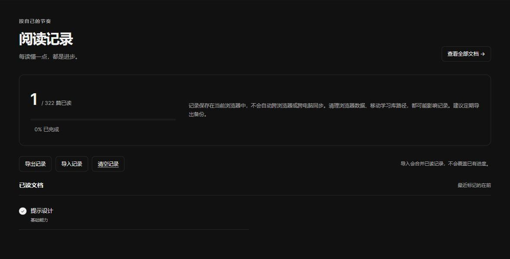

*The single read mark was added for this demonstration and restored afterward.*

### 07 · Choose light or dark

The theme button at the top right switches between light and dark. Articles, directories and the glossary follow your selection. Most images above show dark mode; this is the same hosted home page after switching to light.

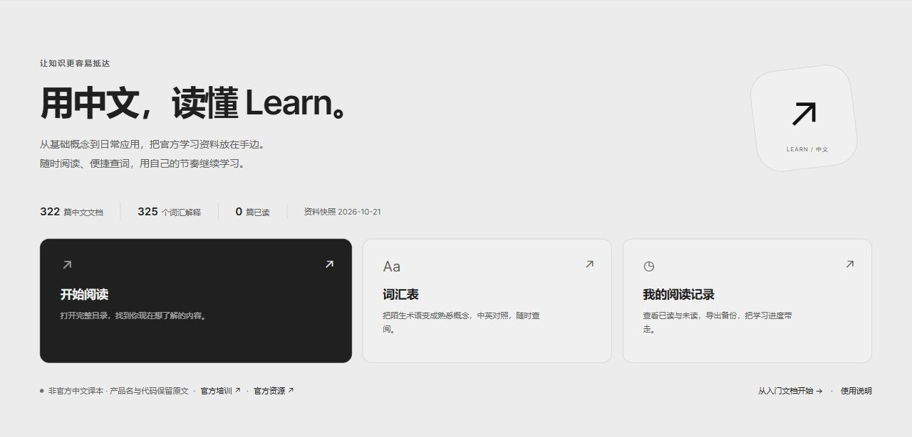

### 08 · Read, browse and look up terms on your phone

Open the hosted reader on your phone. Text reflows for the narrow screen, while buttons open the document directory and glossary categories. Code blocks retain horizontal scrolling so long commands do not have to fit into a narrow column.

The three images show **a light article, a dark document list and a dark glossary search**, captured with the same phone-sized browser viewport. Local-file support varies between mobile operating systems and browsers; use the hosted reader as the starting point on a phone.

<table>
  <tr>
    <td align="center" width="33%"><strong>Read an article</strong></td>
    <td align="center" width="33%"><strong>Find a document</strong></td>
    <td align="center" width="33%"><strong>Look up a term</strong></td>
  </tr>
  <tr>
    <td width="33%">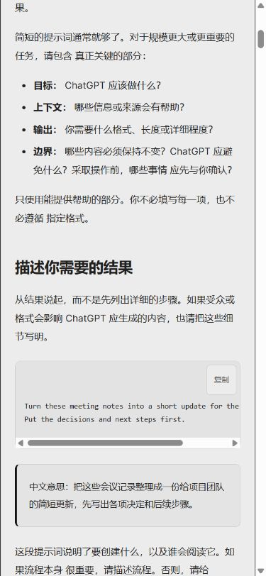</td>
    <td width="33%">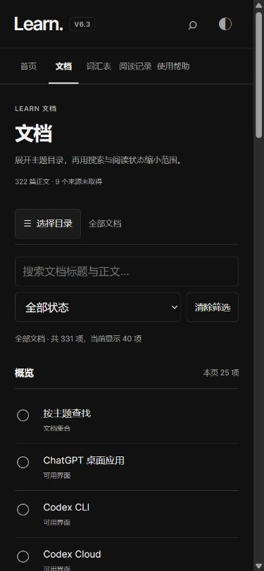</td>
    <td width="33%">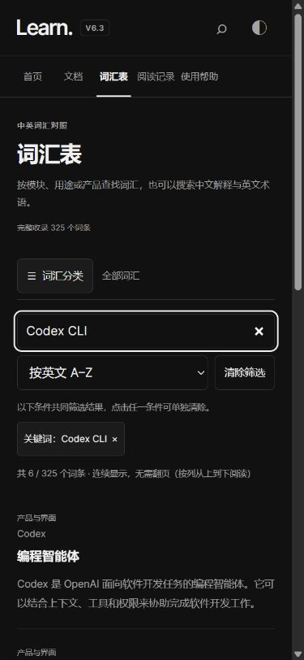</td>
  </tr>
</table>

<a id="start"></a>

## Keep a copy on your computer in three steps

1. Open [Releases](https://github.com/DimmensCK/OpenAI-Learn-Chinese/releases/latest) and choose **Source code (zip)** under **Assets**. It contains the complete reader and learning material.
2. **Extract the entire folder.** Do not run it from inside the archive.
3. On Windows, double-click **开始学习.cmd**, the only file at the root. On macOS/Linux, or without the launcher, open **学习资料/index.html** in a browser.

Reading needs no Node.js, Python, browser extension or local server. Keep the launcher beside the 学习资料 folder.


*This is downloadable V6; its interface differs from hosted V6.3 above.*

A Release's **Source code (zip)** is fixed to its tag. **Code → Download ZIP** downloads the currently selected branch. Extract either archive completely.

### Hosted or downloaded?

| | Hosted reader | Downloadable reader |
|---|---|---|
| Entry | [Try it online](https://learn-chinese-v6.dimmensck.chatgpt.site) | Download and extract |
| Reader | V6.3, full articles with page contents | V6, some long articles split into chapters |
| Network | The site requires a connection and may be restricted on some networks | Saved articles, glossary, search and read marks work offline |
| Content | 2026-10-21 Learn snapshot | Same-date snapshot: 322 articles and 325 terms |
| Progress | Local to the browser and site | Local to the browser and file location |

Neither version automatically syncs across devices. External websites, video, downloads, dynamic demonstrations and some system voices may still need a connection. The archive does not include every external media file.

## Content and review status

- **322 saved articles**, each with Chinese and English content; article sources are on `learn.chatgpt.com`.
- **325 glossary explanations**, retaining existing reference links; some references lead to Developers.
- **9 unavailable-source directory entries**, separately marked and excluded from the 322 articles.
- Snapshot date: **2026-10-21**. The library does not automatically follow changes on the official site.
- Inherited states: 279 draft translations and 43 marked reviewed. These do not certify independent professional human review.

This repository contains the Learn library, not the separate Developers article collection. Source addresses and source checksums help trace provenance; checksums do not prove translation accuracy. See the [usage guide](../学习资料/使用说明.md) and [source-rights note](../学习资料/来源与权利说明.md).

## Where files live

The root keeps the reading entry point; other files are grouped by purpose.

```text
开始学习.cmd                 Windows reading entry point
学习资料/                    Reader, articles, glossary and usage notes
docs/
  README.en.md               English guide
  assets/                    Screenshots and provenance
  legal/                     License scope, code license and notices
  CHANGELOG.md               Release history
scripts/                     Maintenance and structural checks
.github/                     GitHub home page, contribution guide, templates and CI
```

## Common questions

<details>
<summary>The page is blank or says content could not load. What should I check?</summary>

Extract the entire archive. The 学习资料 folder should retain `index.html`, `catalog.js`, `app.js`, `app.css`, `pages/` and `glossary/`. A single HTML file is insufficient. Enable browser JavaScript and try a current browser.

</details>

<details>
<summary>Why did my reading history not appear on another device?</summary>

Records are stored in the browser, not uploaded to an account. Clearing browser data, private browsing and storage restrictions may remove records or prevent persistence. Export before changing device, browser, folder or version, and check backup compatibility before importing. Hosted and local-file addresses do not automatically share records.

</details>

<details>
<summary>Can I change the reader or maintain my own copy?</summary>

You can download the reader source and modify the project's own code under its [license scope](legal/LICENSE.md). Source text, translations, glossary content and third-party text in screenshots do not thereby receive an MIT or CC license. Verify the relevant rights and conditions before publicly redistributing learning content or adding new sources.

</details>

## Help improve it

For a translation correction, open an [issue](https://github.com/DimmensCK/OpenAI-Learn-Chinese/issues) with the article title, official link, original passage and suggested wording. For interface problems, include the device, browser and reproduction steps; hide private details in screenshots. Focused pull requests are welcome too.

Maintenance checks require Node.js 22 or newer. Run from the repository root:

```sh
node scripts/validate.mjs
```

The checks cover package structure, counts, sources, entry resources and root layout, not translation quality. [Contribution guide](../.github/CONTRIBUTING.md) · [Release history](CHANGELOG.md)

Thanks to [OpenAI Learn](https://learn.chatgpt.com) for the original learning material. Maintained by [DimmensCK](https://github.com/DimmensCK). Official names and trademarks belong to their respective owners.

**Code and learning-content rights are separate.** The specified project-authored reader and maintenance code uses [MIT](legal/LICENSE-CODE). Source text, translations, glossary entries and other third-party material retain their respective rights. Authorization covering public mirroring and translation redistribution of the entire collection has not been confirmed. See [NOTICE](legal/NOTICE.md) for details and rights feedback.

If the library helped you finish a lesson, a Star can make it easier to find again. If a passage needs fixing, please tell me which one.
